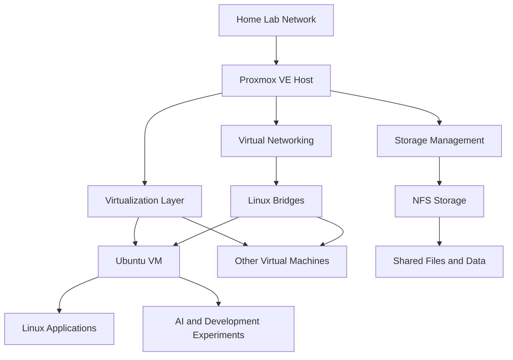

# Proxmox Home Lab

## Overview

This repository documents my personal Proxmox VE Home Lab, including virtualization, virtual machines, storage management, networking, and infrastructure administration.

The primary objective of this project is to build and maintain a self-hosted virtualization environment that can run multiple Linux-based workloads and provide a foundation for experimentation with infrastructure, networking, automation, and local AI applications.

Proxmox VE is used as the central virtualization platform, allowing me to manage virtual machines, virtual networking, and storage resources from a centralized management interface.

This home lab also acts as the underlying infrastructure for several other personal projects, including local AI experimentation, document processing, and self-hosted applications.

## Project Objectives

- Build and maintain a self-hosted virtualization environment.
- Run Linux-based virtual machines.
- Explore virtual networking and network interfaces.
- Integrate network storage using NFS.
- Enable file sharing between the virtualization host and other machines.
- Manage virtual machine resources.
- Experiment with self-hosted infrastructure and applications.
- Provide a foundation for local AI and automation projects.
- Develop practical Linux system administration and virtualization experience.

## Hardware and Software

| Component | Configuration |
|---|---|
| Virtualization Platform | Proxmox VE |
| Hostname | pve03 (local hostname) |
| Guest Operating Systems | Linux / Ubuntu |
| Virtualization | KVM/QEMU |
| Storage Integration | NFS |
| File Sharing | NFS / SMB |
| Networking | Linux Bridges and Virtual Interfaces |
| Primary Administration | Proxmox Web Interface and Linux CLI |

Exact host hardware specifications and Proxmox version will be added after verification.

## Infrastructure Architecture

The Proxmox server acts as the central virtualization platform.

It hosts virtual machines that can be used for different home lab workloads.

### Architecture Diagram



## Proxmox VE Configuration

Proxmox VE is used to manage the virtualization environment.

The main administrative activities include:

- Managing virtual machines.
- Starting, stopping, and restarting virtual machines.
- Allocating CPU and memory resources.
- Managing virtual machine disks.
- Configuring virtual network interfaces.
- Monitoring host resource utilization.
- Managing storage connections.
- Troubleshooting virtualization and connectivity issues.

### Useful Proxmox Commands

Check Proxmox version:

```bash
pveversion -v
```

List virtual machines:

```bash
qm list
```

List containers:

```bash
pct list
```

Check storage availability:

```bash
pvesm status
```

Check Proxmox services:

```bash
systemctl status pveproxy
systemctl status pvedaemon
systemctl status pvestatd
```

## Virtual Machine Management

The environment includes Ubuntu-based virtual machines for running and testing different workloads.

One of the configured machines is:

```text
VM Name: john-prox-ubu
Operating System: Ubuntu
Platform: Proxmox VE
```

Virtual machines provide isolated environments for installing applications, testing configurations, and experimenting with Linux-based technologies.

### Useful VM Management Commands

List available VMs:

```bash
qm list
```

Check the configuration of a VM:

```bash
qm config <VMID>
```

Start a VM:

```bash
qm start <VMID>
```

Stop a VM:

```bash
qm shutdown <VMID>
```

Check VM status:

```bash
qm status <VMID>
```

Replace `<VMID>` with the actual virtual machine ID.

## Storage Management and NFS Integration

Storage management is an important component of this home lab.

NFS has been used to provide shared storage and file access between the Proxmox environment and other Linux machines.

The environment includes:

- NFS-backed storage.
- Shared directories.
- File transfers between Linux machines.
- Storage access from Ubuntu virtual machines.
- Integration with other home lab devices.

### Example Storage Locations

The following paths were used during previous storage work:

**Proxmox storage environment:**

```text
/mnt/proxNFS2/
```

**Ubuntu VM NFS mount:**

```text
/mnt/NFSprox/proxNFS
```

These are environment-specific paths. Their exact mount configurations and persistence settings will be documented separately.

### Useful Storage Commands

Check mounted filesystems:

```bash
df -h
```

Display mounted filesystems:

```bash
findmnt
```

Check NFS mounts:

```bash
mount | grep nfs
```

Check Proxmox storage:

```bash
pvesm status
```

## Virtual Networking

Proxmox provides virtual networking through Linux bridges and virtual network interfaces.

The environment has been configured and investigated using:

- Linux network interfaces.
- Linux bridges.
- Virtual machine network adapters.
- TAP interfaces.
- Wireless connectivity.
- Multiple physical network interfaces.

Some interfaces observed during troubleshooting include:

```text
vmbr0
docker0
tap101i0
fwbr101i0
```

These interface names reflect previously observed host configurations and may change depending on the current VM and networking configuration.

Detailed multi-network routing and Wi-Fi connectivity experiments are documented in the separate Multi-network Home Lab Connectivity project.

### Useful Networking Commands

List network interfaces:

```bash
ip -br addr
```

Display network bridges:

```bash
ip link show type bridge
```

Check routing:

```bash
ip route
```

Display bridge information:

```bash
bridge link
```

## Home Lab Workloads

The Proxmox infrastructure provides an environment for running and experimenting with different workloads.

Examples from this home lab include:

### 1. Ubuntu Virtual Machine

Used for Linux-based application development, testing, and infrastructure experiments.

### 2. Local AI Experiments

The broader home lab includes local AI experimentation using Ollama and locally hosted language models.

The AI implementation and model configurations are documented separately in the Local AI Environment repository.

### 3. Document Knowledge Base

The home lab also supports document retrieval and RAG-related experiments using ChromaDB.

See the separate PDF RAG / Document Knowledge Base repository.

### 4. Infrastructure and Network Experiments

The virtualization platform provides a foundation for experimenting with networking, storage, and integration with other home lab machines.

## Monitoring and Troubleshooting

The following commands are useful when diagnosing common Proxmox issues.

### Check System Resources

```bash
free -h
```

```bash
df -h
```

### Check CPU and Memory Utilization

```bash
top
```

### Check Proxmox Services

```bash
systemctl --failed
```

### Check VM Status

```bash
qm list
```

### Check Network Configuration

```bash
ip addr
ip route
```

### Check NFS Connectivity

```bash
findmnt -t nfs,nfs4
```

### Check System Logs

```bash
journalctl -xe
```

These commands provide a starting point for troubleshooting virtualization, storage, and host-level issues.

## Backup and Recovery

Backup and recovery are important considerations for maintaining a reliable home lab.

The repository will document:

- Virtual machine backup procedures.
- Storage backup strategies.
- Configuration backups.
- VM restoration procedures.
- Recovery of NFS-mounted storage.

Exact backup schedules and retention policies will be documented after the current implementation is verified.

## Security Considerations

This is a personal home lab documented for public GitHub publication.

Do not commit:

- Proxmox administrator credentials.
- SSH private keys.
- Passwords and authentication tokens.
- Public IP addresses associated with the home connection.
- Router credentials.
- Private NFS or SMB authentication files.
- Unredacted configuration backups.
- Sensitive VM data or disk images.

All published configuration files should be reviewed and sanitized before uploading.

## Future Improvements

- Document the complete Proxmox hardware configuration.
- Document the installed Proxmox VE version.
- Create detailed VM inventory and configuration records.
- Document NFS storage integration.
- Implement and document a consistent backup strategy.
- Improve storage monitoring.
- Document VM restoration procedures.
- Improve network monitoring.
- Add automated infrastructure health checks.
- Document resource allocation and performance observations.

## Learning Outcomes

This project demonstrates practical experience with:

- Proxmox VE administration.
- KVM/QEMU virtualization.
- Linux virtual machines.
- Virtual networking and bridges.
- NFS storage integration.
- Linux storage administration.
- Network connectivity troubleshooting.
- Infrastructure monitoring.
- Linux system administration.
- Self-hosted home lab architecture.

## Disclaimer

This is a personal home lab project intended for learning, experimentation, and research.

Configurations, installed software, and infrastructure components may evolve over time.

## Author

Personal Home Lab – Virtualization and Infrastructure

**Technologies:** Proxmox VE, Linux, Ubuntu, KVM/QEMU, NFS, SMB, Linux Bridges, Virtual Networking.
